<a id="top"></a>

<p align="center"></p>

<p align="center"><a href="#demo"></a><a href="#architecture"></a><a href="#try-it"></a><a href="#screenshots"></a><a href="#tests"></a><a href="#setup"></a></p>

NoteGPT answers questions from 13 sets of AI course notes and shows the exact passages behind each answer. When the notes don't cover a question, it says so instead of guessing.

It is the Week 8 Day 2 RAG notebook rebuilt as a website: a React frontend and a FastAPI backend, deployed together on one free Vercel project, with no paid server and no GPU.

<p align="center"></p>

## Demo

<p align="center">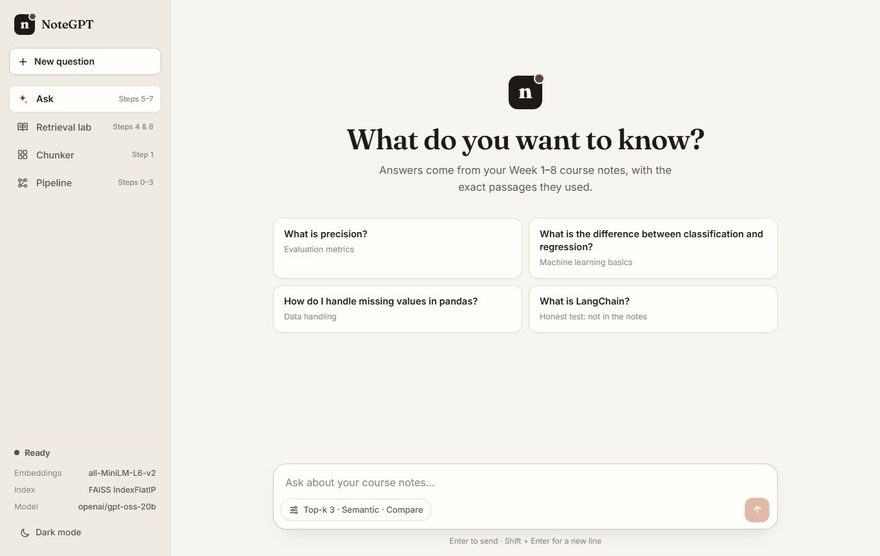</p>

## Architecture

Follow the moving dot: the numbers trace one question through the system, and the caption explains each step. The letters are the index build, which runs once on your computer.

<p align="center"><a href="docs/assets/architecture.svg"></a></p>

**Click a component** to jump to how it works:

<p align="center"><a href="#c-ui"></a><a href="#c-api"></a><a href="#c-embed"></a><a href="#c-search"></a><a href="#c-confidence"></a><a href="#c-prompt"></a><a href="#c-llm"></a><a href="#c-build"></a></p>

<a id="c-ui"></a>
<details>
<summary><b>1 · 8 — React UI</b> <sub><code>src/</code></sub></summary>

<br>

Four pages share a sidebar shell:

| Page | What you do there |
|---|---|
| **Ask** | Chat with the notes. Each answer folds out its passages, a model-only comparison and the full prompt. |
| **Retrieval lab** | Search without generating. Change top-k, switch to hybrid, check whether a fact is in the results. |
| **Chunker** | Paste text and see where the splitter cuts and what overlaps. |
| **Pipeline** | See the files, chunks and vectors behind every answer. |

Answers render as Markdown with KaTeX math. Light and dark themes are built in.

</details>

<a id="c-api"></a>
<details>
<summary><b>2 — FastAPI</b> <sub><code>backend/app.py</code></sub></summary>

<br>

One serverless function serves every route. Serverless has no startup hook, so the pipeline is built on the first request and kept in memory while the function stays warm.

| Method | Path | Notebook step | What it does |
|---|---|---|---|
| GET | `/api/health` | – | Status; also warms up the function |
| GET | `/api/pipeline` | 0b, 1b, 3 | Files, chunk stats, index info |
| POST | `/api/chunk-test` | 1a | Chunk any text |
| POST | `/api/retrieve` | 4, 7, 8 | Top-k chunks, top score, low-confidence flag |
| POST | `/api/check-facts` | 4c | Marks which chunks contain given facts |
| POST | `/api/prompt` | 5 | The augmented prompt |
| POST | `/api/ask` | 6, 7 | Answers with and without RAG |
| POST | `/api/rebuild` | 2, 3 | Rebuilds the index until the function sleeps |

Interactive docs when running locally: <http://localhost:8000/docs>

</details>

<a id="c-embed"></a>
<details>
<summary><b>3 — Embedder</b> <sub><code>backend/embedder.py</code></sub></summary>

<br>

Runs the same `all-MiniLM-L6-v2` model as the notebook, with the same mean pooling, on **ONNX Runtime instead of PyTorch**. ONNX Runtime is about a tenth of PyTorch's size, which is what lets it fit in a free Vercel function. Each question embeds a single sentence.

</details>

<a id="c-search"></a>
<details>
<summary><b>4 — Index search</b> <sub><code>backend/flatindex.py</code> · <code>backend/tfidf.py</code></sub></summary>

<br>

**Semantic mode** reads the FAISS `IndexFlatIP` file directly and runs the same exact inner-product search in NumPy, saving about 65 MB of FAISS library. A test checks that the results match real FAISS.

**Hybrid mode** takes the top 20 candidates from both vector search and TF-IDF, then ranks by:

```
combined score = cosine similarity + (TF-IDF score / highest TF-IDF score)
```

TF-IDF is written in NumPy because scikit-learn is too big for Vercel. A test checks it gives the same numbers as scikit-learn.

</details>

<a id="c-confidence"></a>
<details>
<summary><b>5 — Confidence</b> <sub><code>backend/app.py</code></sub></summary>

<br>

If the best passage's cosine score is under `LOW_SCORE_THRESHOLD` (default `0.4`), the answer gets a **Weak match** badge. Hybrid results use their cosine part, so the threshold means the same thing in both modes.

</details>

<a id="c-prompt"></a>
<details>
<summary><b>6 — Prompt</b> <sub><code>backend/rag.py</code></sub></summary>

<br>

```text
Answer the question using ONLY the context below. If the answer is not in the
context, say "I do not know". Do not guess. Cite the source file for each fact
you use.

Context:
[Source 1: 12_evaluation_metrics.txt]
...

Question: What is precision?
Answer:
```

The **Prompt** button under every answer shows the exact text that was sent.

</details>

<a id="c-llm"></a>
<details>
<summary><b>7 — LLM client</b> <sub><code>backend/llm.py</code></sub></summary>

<br>

Calls any OpenAI-compatible chat API using only the Python standard library. The default is Groq with `openai/gpt-oss-20b`. The with-notes and without-notes answers are requested at the same time, so the comparison adds no extra wait.

</details>

<a id="c-build"></a>
<details>
<summary><b>A–D — Index build</b> <sub><code>build_index.py</code> · <code>backend/chunker.py</code></sub></summary>

<br>

`build_index.py` splits the notes into chunks of 300 characters with 50 of overlap, embeds all 1,342, and saves `rag.index`, `tfidf.npz` and `meta.json` to `backend/index/`. These files are committed, so Vercel only has to load them.

`meta.json` stores a fingerprint of the notes and chunk settings. If the notes change without a rebuild, the app notices the mismatch and rebuilds on the spot, which is much slower.

</details>

<details>
<summary><b>Open the request timeline</b> <sub>zoom and pan with the diagram's controls</sub></summary>

<br>

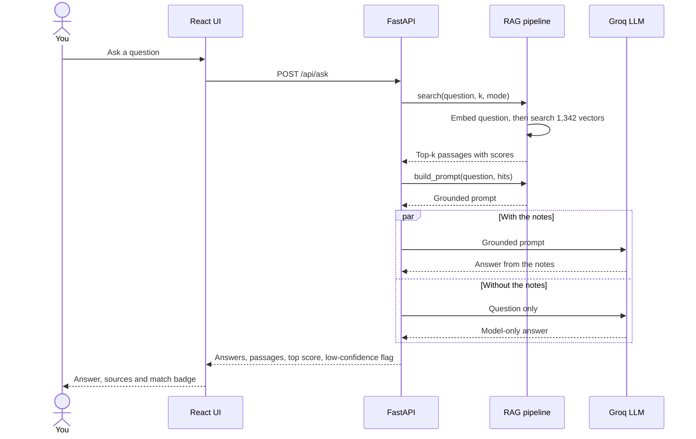

</details>

<details>
<summary><b>Compare with the notebook</b> <sub>what stayed the same and what changed</sub></summary>

<br>

| Notebook step | Website |
|---|---|
| 0b Load corpus, 1 Chunk | Same code, `backend/chunker.py` |
| 2 Embed (all-MiniLM-L6-v2) | **Same model**, run with ONNX Runtime instead of PyTorch |
| 3 FAISS IndexFlatIP, save/load | **Same index file**, built once by `build_index.py`, searched with NumPy on Vercel |
| 4 Retrieve top-k, 4c fact check | Retrieval lab page |
| 5 Augmented prompt | Same prompt text, plus a Prompt button |
| 6 Generate with and without RAG | **Groq API**, both answers in parallel |
| 7 Honest test (score < 0.4) | Automatic Weak match badge |
| 8 Hybrid search (TF-IDF) | Same formula, rewritten in NumPy |

**The answer model changed.** The Hugging Face credits for DeepSeek ran out (402 error), and local models need a server that Vercel's free plan can't provide. Groq's free tier is fast and needs no card.

**Retrieval did not change.** It uses the same chunker, embedding model, index, prompt and hybrid formula, so scores match the notebook: about 0.662 for "What is precision?".

</details>

<p align="right"><a href="#top">↑ Back to top</a></p>

## Try it

These are real responses recorded from the running app on 2026-11-08. Pick a question:

<details>
<summary><b>What is precision?</b> &nbsp;🟢 Strong match · 0.662 · 1.1 s</summary>

<br>

> **Precision** is the proportion of correctly predicted positives out of all instances the model labeled as positive. It is calculated as
>
> $$\text{Precision} = \frac{TP}{TP + FP}$$
>
> where **TP** = true positives and **FP** = false positives. Low precision indicates many false alarms.
>
> *Source: 12_evaluation_metrics.txt*

| Rank | Source | Score |
|---|---|---|
| 1 | `12_evaluation_metrics.txt` | 0.662 |
| 2 | `12_evaluation_metrics.txt` | 0.593 |
| 3 | `12_evaluation_metrics.txt` | 0.580 |

</details>

<details>
<summary><b>What is LangChain?</b> &nbsp;🔴 Weak match · 0.319 · 0.6 s</summary>

<br>

LangChain isn't in the course notes, so this is the honest test.

**With the notes:**

> I do not know.

**Model only, without the notes** (first sentence):

> **LangChain** is an open‑source framework that lets developers build applications around large language models (LLMs) by providing reusable components for prompts, chains, memory, and integrations with external tools.

The model knows the topic, but the grounded prompt keeps it from presenting that as something the notes say.

| Rank | Source | Score |
|---|---|---|
| 1 | `09_ml_scikit_learn.txt` | 0.319 |
| 2 | `13_sms_spam_finetuning.txt` | 0.317 |
| 3 | `06_rag_concepts.txt` | 0.248 |

</details>

<details>
<summary><b>What is the difference between classification and regression?</b> &nbsp;🟢 Strong match · 0.729 · 1.4 s</summary>

<br>

First sentence of the answer:

> **Classification** predicts a *discrete category* (e.g., “spam” vs. “not spam”), while **regression** predicts a *continuous value* (e.g., price or temperature).

The top three passages all came from `09_ml_scikit_learn.txt`. [See the full answer in dark mode.](docs/screenshots/11-dark-mode.png)

</details>

<details>
<summary><b>Split-answer test: two facts from two different notes</b> &nbsp;🔎 both not found</summary>

<br>

**Question:** What accuracy did fine-tuning reach on SMS spam, and what is RAG? (k = 5)

| Fact | In the top 5 passages? |
|---|---|
| `0.991` | ❌ Not found |
| `Retrieval-Augmented Generation` | ❌ Not found |

The search finds the right files, with a top score of 0.730, but not the chunks holding these exact strings. This is the same weakness the notebook shows at Step 4c.

</details>

<br>

<p align="center"></p>

<p align="right"><a href="#top">↑ Back to top</a></p>

## Screenshots

Click any image to open it full size.

| Ask | Answer with sources |
|---|---|
| [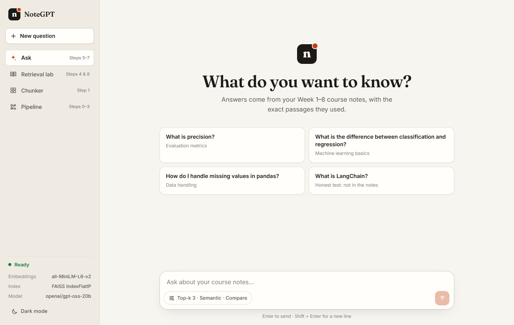](docs/screenshots/01-ask-welcome.png) | [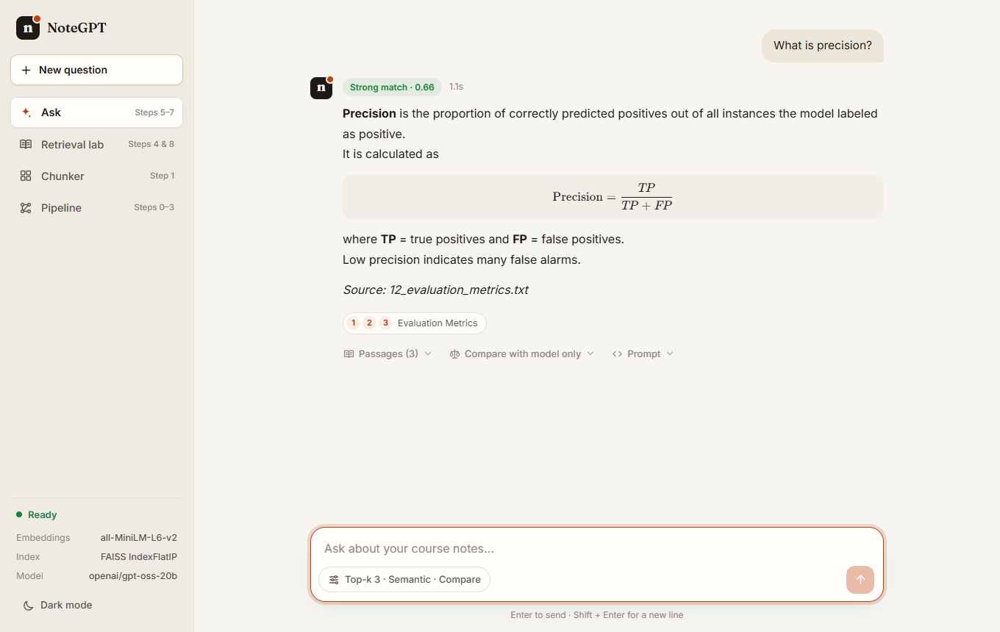](docs/screenshots/02-ask-strong-match.png) |
| **Honest test** | **Retrieval lab** |
| [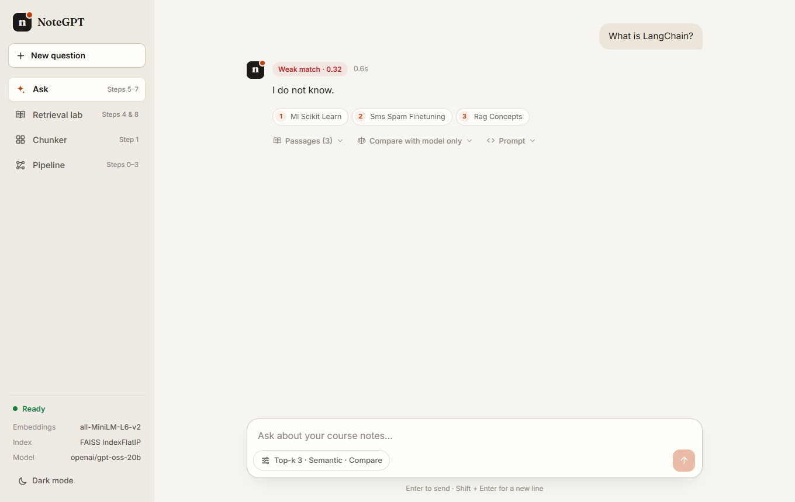](docs/screenshots/06-ask-weak-match.png) | [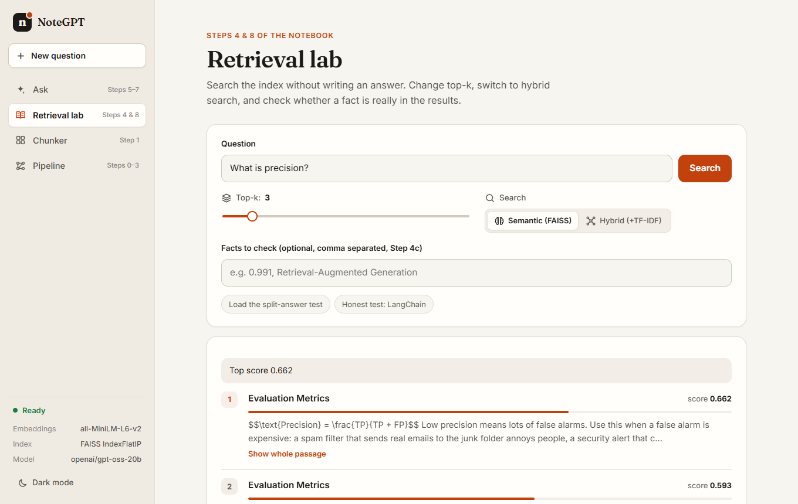](docs/screenshots/07-retrieval-precision.png) |
| **Pipeline** | **Dark mode** |
| [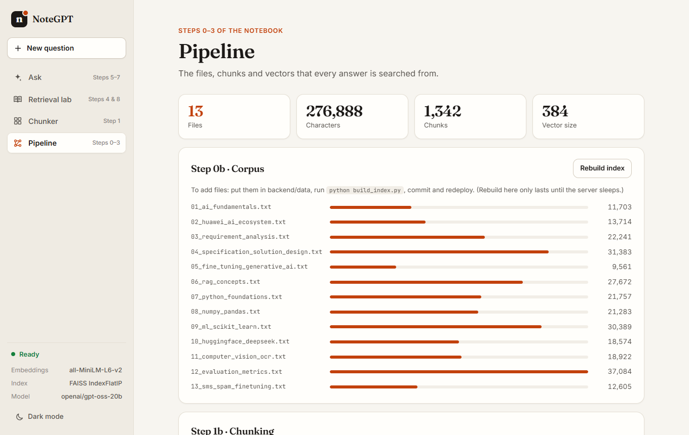](docs/screenshots/10-pipeline.png) | [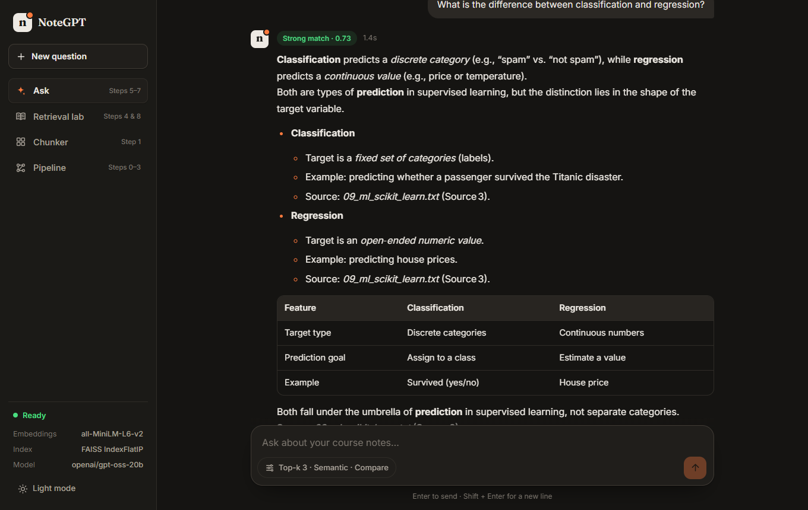](docs/screenshots/11-dark-mode.png) |

<details>
<summary><b>More: passages, comparison, prompt, fact check, chunker</b></summary>

<br>

| Passages | Compare with model only |
|---|---|
| [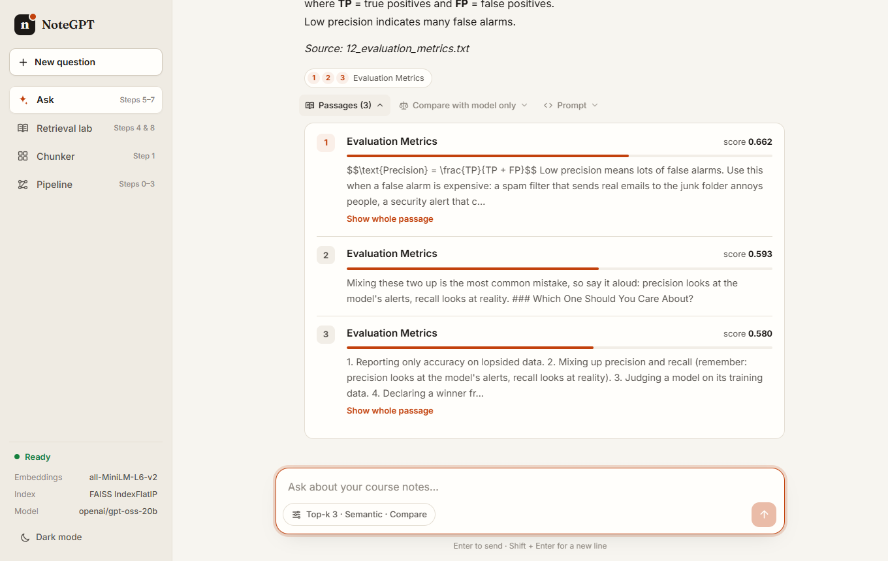](docs/screenshots/03-ask-passages.png) | [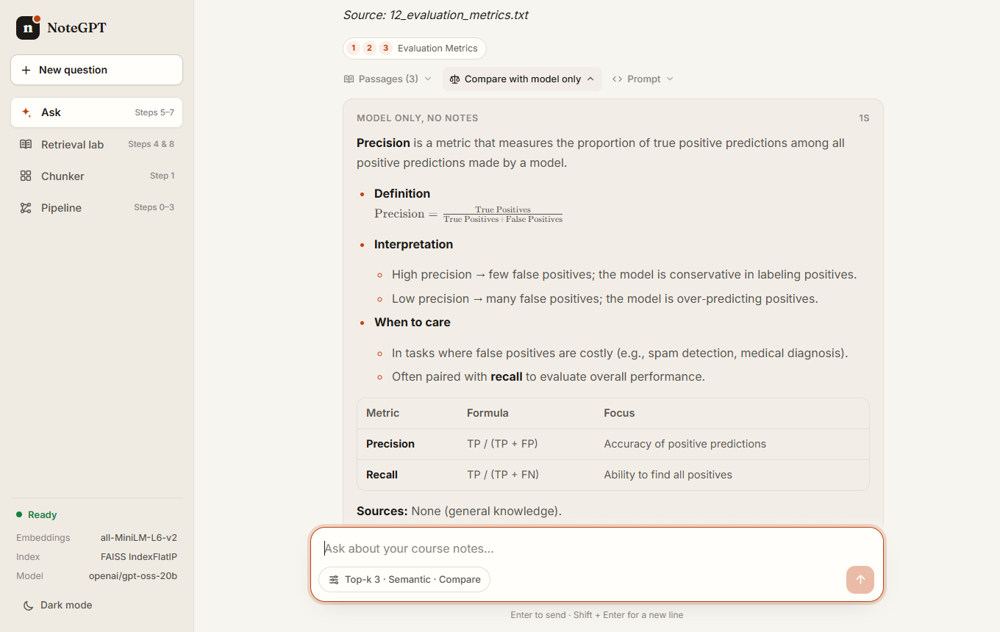](docs/screenshots/04-ask-compare.png) |
| **Full prompt** | **Fact check** |
| [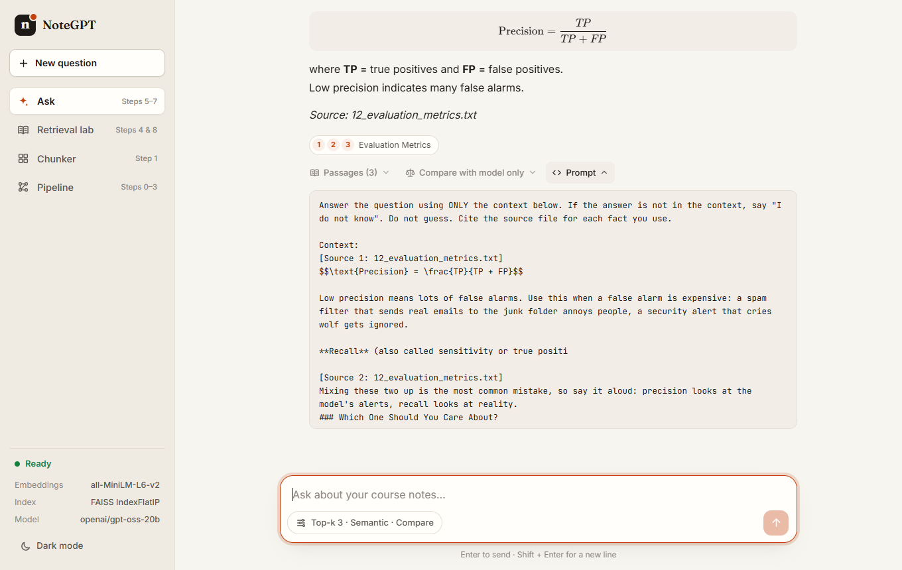](docs/screenshots/05-ask-prompt.png) | [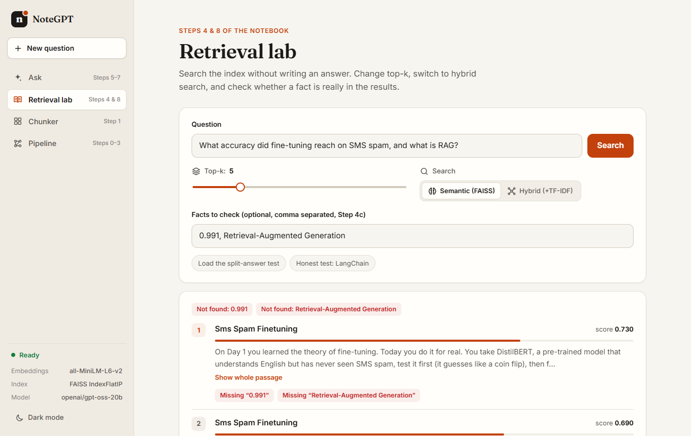](docs/screenshots/08-retrieval-fact-check.png) |
| **Chunker** | |
| [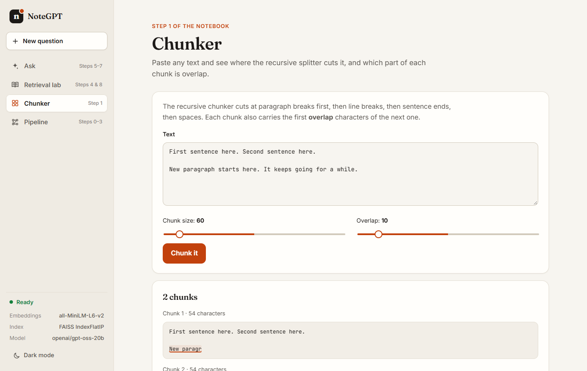](docs/screenshots/09-chunker.png) | |

</details>

<p align="right"><a href="#top">↑ Back to top</a></p>

## Tests

<p align="center"></p>

The 12 unit tests need no model download. Run them with no API key in the environment:

```bash
# Git Bash, macOS or Linux
LLM_API_KEY= python -m pytest -v
```

> [!NOTE]
> With a real key in `.env`, `test_ask_errors` fails because the app picks up that key when the test expects none. In PowerShell, setting the variable to an empty string removes it, so `.env` still applies there. Use Git Bash, or move `.env` aside while the tests run.

### End-to-end checks

Each check ran in the real app with the real model and index.

| | Check | Expected | Result | Evidence |
|---|---|---|---|---|
| ✅ | Pipeline stats | 13 files, 276,888 characters, 1,342 chunks, 384 dimensions | Exact match | [Screenshot](docs/screenshots/10-pipeline.png) |
| ✅ | Retrieval: "What is precision?", k = 3 | Top score about 0.662 | 0.662 | [Screenshot](docs/screenshots/07-retrieval-precision.png) |
| ✅ | Split-answer test | Both facts not found | Both not found | [Screenshot](docs/screenshots/08-retrieval-fact-check.png) |
| ✅ | Ask: "What is precision?" | Answer gives TP / (TP + FP) | TP / (TP + FP), strong match | [Screenshot](docs/screenshots/02-ask-strong-match.png) |
| ✅ | Ask: "What is LangChain?" | Low-confidence warning | Weak match 0.319, "I do not know." | [Screenshot](docs/screenshots/06-ask-weak-match.png) |

<p align="right"><a href="#top">↑ Back to top</a></p>

## Setup

You need **Python 3.10+**, **Node.js 18+** and a free **[Groq API key](https://console.groq.com/keys)**. The course notes and the built index are already in the repository.

<details open>
<summary><b>1. Install</b></summary>

<br>

```bash
git clone https://github.com/maoozgul20/rag-website.git
cd rag-website
python -m venv .venv
```

Activate the environment. On Windows PowerShell:

```powershell
.venv\Scripts\Activate.ps1
```

On macOS or Linux:

```bash
source .venv/bin/activate
```

Then install the packages:

```bash
pip install -r requirements-dev.txt
npm install
```

</details>

<details>
<summary><b>2. Add your key</b></summary>

<br>

Copy `.env.example` to `.env` and set:

```
LLM_API_KEY=gsk_your_key_here
```

`.env` is in `.gitignore`, so the key stays out of the repository.

</details>

<details>
<summary><b>3. Run locally</b></summary>

<br>

Start the backend in one terminal:

```bash
uvicorn api.index:app --port 8000
```

Start the frontend in another:

```bash
npm run dev
```

Open <http://localhost:5173>. The sidebar should say **Ready**. The first start downloads the 90 MB embedding model.

</details>

<details>
<summary><b>4. Deploy to Vercel</b></summary>

<br>

1. Push the project to GitHub, including `backend/data` and `backend/index`.
2. On **vercel.com → Add New → Project**, import the repository and leave Root Directory as the project root.
3. In **Settings → Environment Variables**, add `LLM_API_KEY`.
4. Click **Deploy**, then repeat the [end-to-end checks](#end-to-end-checks) on your URL.

The frontend and backend share one URL, so no CORS setup is needed.

</details>

<details>
<summary><b>Change the course notes</b></summary>

<br>

Add or edit `.txt` files in `backend/data/`, then rebuild and commit the index:

```bash
python build_index.py
```

You should see the file and chunk counts and a sanity check. The **Rebuild index** button on the Pipeline page only lasts until the function sleeps.

</details>

<details>
<summary><b>Settings</b></summary>

<br>

| Variable | Default | Meaning |
|---|---|---|
| `LLM_API_KEY` | – | **Required** for the Ask page |
| `LLM_BASE_URL` | `https://api.groq.com/openai/v1` | Any OpenAI-compatible API |
| `LLM_MODEL` | `openai/gpt-oss-20b` | Model name at that provider |
| `MAX_TOKENS` | `800` | Maximum answer length |
| `TEMPERATURE` | `0.2` | Answer randomness |
| `LOW_SCORE_THRESHOLD` | `0.4` | Score below which an answer is a weak match |

</details>

<details>
<summary><b>Project structure</b></summary>

<br>

```
├── api/index.py          Vercel entry point
├── backend/
│   ├── app.py            FastAPI endpoints
│   ├── rag.py            corpus, chunks, index, retrieval, hybrid, prompt
│   ├── flatindex.py      reads and writes the FAISS file, NumPy search
│   ├── chunker.py        recursive chunker from the notebook
│   ├── embedder.py       MiniLM on ONNX Runtime with mean pooling
│   ├── tfidf.py          TF-IDF in NumPy
│   ├── llm.py            OpenAI-compatible API client
│   ├── config.py         settings from environment or .env
│   ├── data/             the 13 course files
│   └── index/            the prebuilt index
├── src/                  React frontend
├── docs/                 README images
├── build_index.py        builds the index once
├── tests/test_core.py    12 tests
└── vercel.json           routes /api/* to the backend, the rest to React
```

</details>

<details>
<summary><b>Why it fits on free Vercel</b></summary>

<br>

1. **No PyTorch or FAISS library in the function.** ONNX Runtime and a NumPy search keep it at about 170 MB, under Vercel's 225 MB limit.
2. **The index is built once.** Vercel loads it in milliseconds and only embeds the one question you ask.
3. **Groq generates quickly.** The recorded answers above took 0.6–1.4 s.
4. **Both answers run in parallel,** so the comparison adds no extra wait.

</details>

<details>
<summary><b>Known limits</b></summary>

<br>

- **Rate limits:** heavy use of Groq's free tier can return a 429 error. Wait a moment and try again.
- **Cold starts:** the first request after idle takes about 5–10 s while the function starts and downloads the model.
- **Small chunks:** at 300 characters, some facts are hard to retrieve, as the split-answer test shows.

</details>

<p align="right"><a href="#top">↑ Back to top</a></p>
